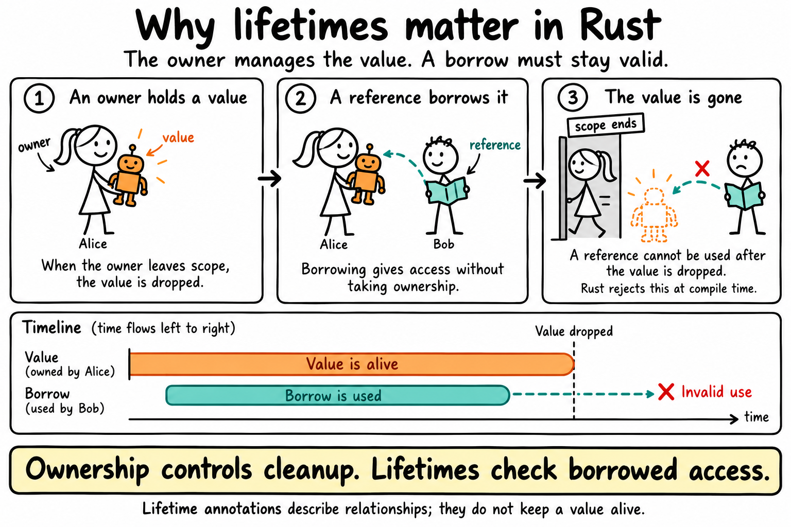

# Lifetimes: Borrowing Toys

A reference can never outlive the thing it points to. Lifetimes are how Rust checks that.

## The idea



Alice owns a Robot. Bob doesn't take it. He holds a **magic hologram** of Alice's Robot. It's Bob's *reference*: it lets him see the toy without owning it.

A magic hologram is only real while the toy is still there. Once Alice leaves and the Robot is dropped, Bob's magic hologram would show a toy that no longer exists. Other languages call this a "dangling pointer" bug. Rust refuses to compile it.

## The code

The code is in [`src/main.rs`](src/main.rs). It's the picture above in code: `Borrower` is Bob holding his magic hologram, and `toy` is the magic hologram of Alice's Robot.

```rust
struct Borrower<'a> {
    toy: &'a str,
}
```

`'a` ties Bob's magic hologram to Alice's toy. Bob can keep the magic hologram only while Alice still has the Robot.

## Run it

```sh
cargo run
```

Output:

```
Bob is holding: Robot
```

## Try it yourself

1. Uncomment the `/* ... */` block in [`src/main.rs`](src/main.rs) and run `cargo run`. Alice's Robot is dropped while Bob still holds a magic hologram of it, so Rust refuses to compile:

   ```
   `alice_toy` does not live long enough
   ```

2. Remove `<'a>` from `struct Borrower`. The compiler asks for a lifetime:

   ```
   missing lifetime specifier
   ```

   If Bob holds a magic hologram, Rust needs to know how long the toy it shows will be there.
