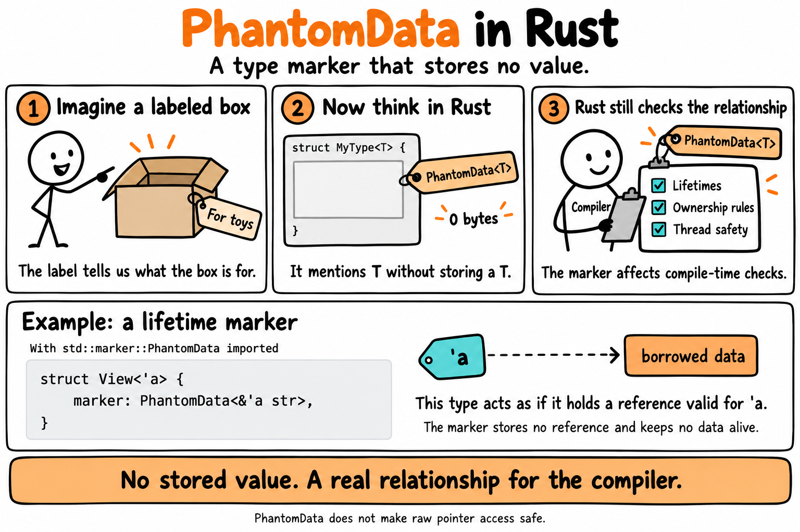

# PhantomData: Type-Safe IDs

Use the type system to stop you from mixing up IDs that look the same.

## The idea



A user ID and an order ID are both just numbers. If both are plain `u64`, nothing stops you from passing an order ID where a user ID belongs.

This example gives each ID a label:

```rust
struct Id<T> {
    number: u64,
    marker: PhantomData<T>,
}
```

`Id<User>` and `Id<Order>` hold the same kind of number, but Rust treats them as different types. A function that asks for `Id<User>` won't accept `Id<Order>`.

## Why `PhantomData`?

`T` is never stored in `Id`. Rust doesn't allow a type parameter that isn't used, so `PhantomData<T>` marks it as used. It takes up no space at runtime.

## Run it

```sh
cargo run
```

Output:

```
Finding user 42
```

## Try it yourself

1. In [`src/main.rs`](src/main.rs#L36), uncomment the call on line 36 by deleting the `//`:

   ```rust
   find_user(order_id);
   ```

   Run `cargo run`. The compiler stops you:

   ```
   expected `Id<User>`, found `Id<Order>`
   ```

   Both IDs hold `42`, but their types are different, so you can't pass an order ID where a user ID belongs.

2. Delete the `marker` field in two places: in the struct on [line 9](src/main.rs#L9), and in `new` on [line 18](src/main.rs#L18) (line numbers are from the original file):

   ```rust
   marker: PhantomData<T>, // line 9, in `struct Id<T>`
   ```

   ```rust
   marker: PhantomData,    // line 18, in `Id::new`
   ```

   Run `cargo run`. Now nothing in `Id` uses `T`, and the compiler complains:

   ```
   type parameter `T` is never used
   ```

   Its help message even suggests the fix: *"…or using a marker such as `PhantomData`"*. Put the `marker` lines back before step 3.

3. Add your own ID type. Next to `User` and `Order` on [lines 4–5](src/main.rs#L4-L5), add:

   ```rust
   struct Product;
   ```

   Below `find_user` on [lines 23–25](src/main.rs#L23-L25), add a function that only accepts `Id<Product>`:

   ```rust
   fn find_product(id: Id<Product>) {
       println!("Finding product {}", id.number);
   }
   ```

   Then call it in `main`:

   ```rust
   let product_id = Id::<Product>::new(7);
   find_product(product_id);
   ```

   Run `cargo run`. You'll see a new line in the output:

   ```
   Finding product 7
   ```

   Try passing `user_id` to `find_product`. The compiler stops you, just like in step 1.
